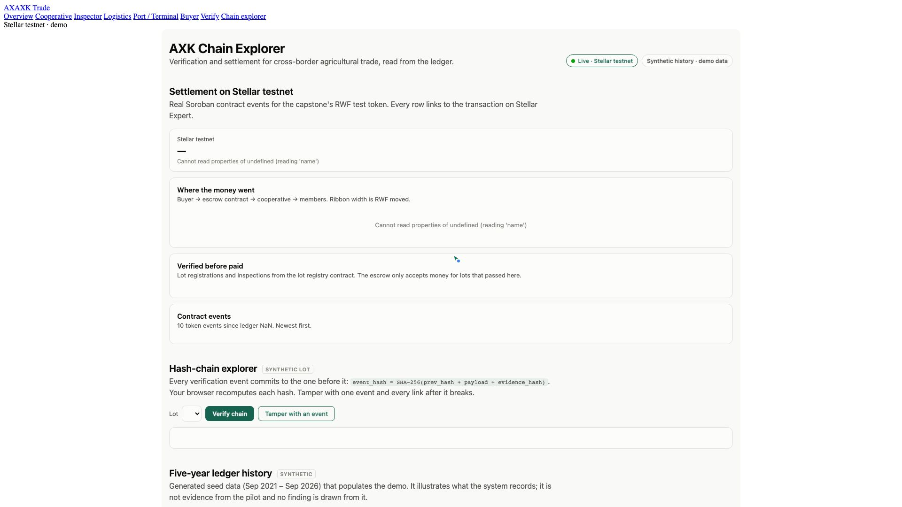
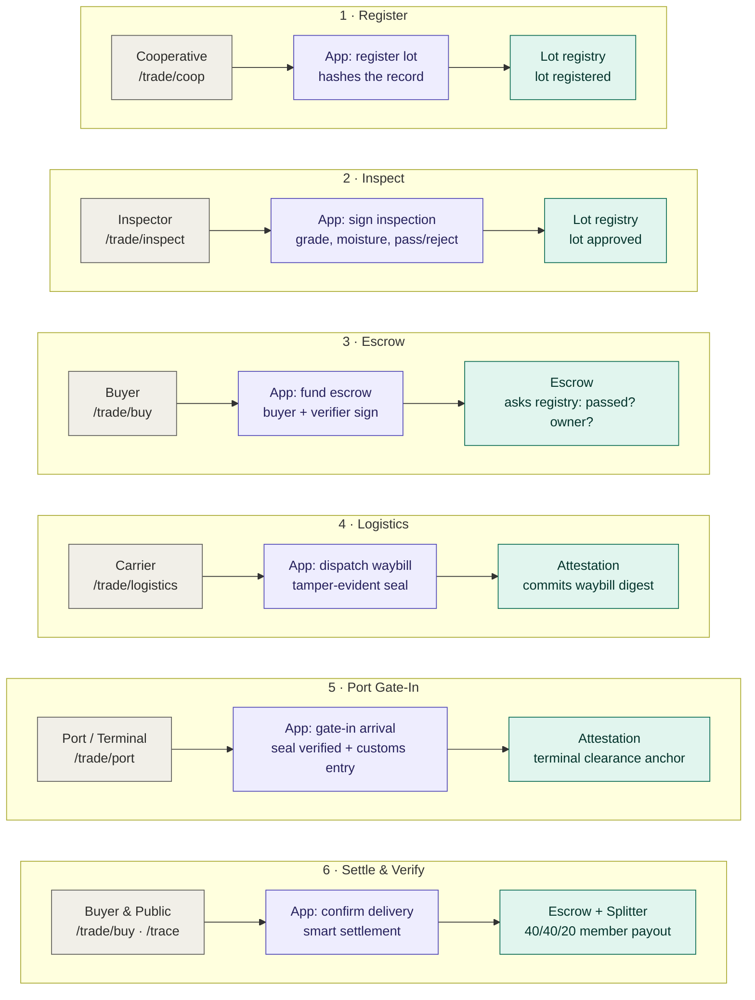
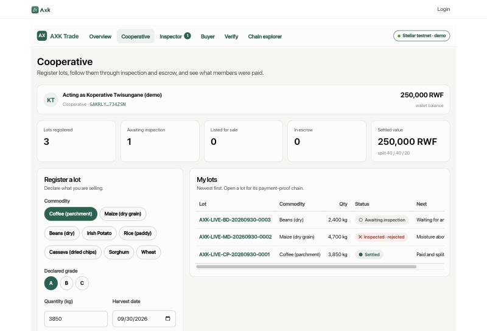
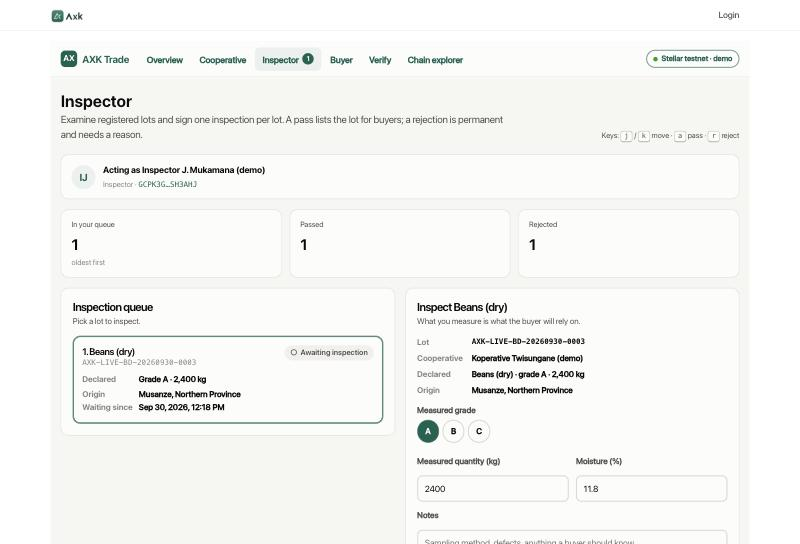
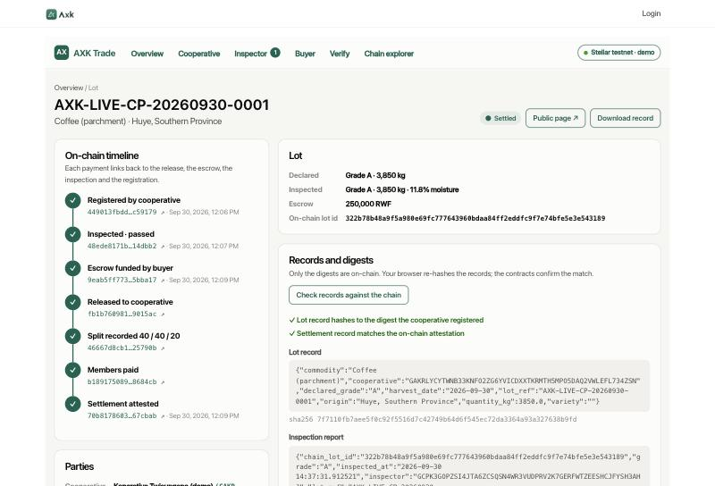
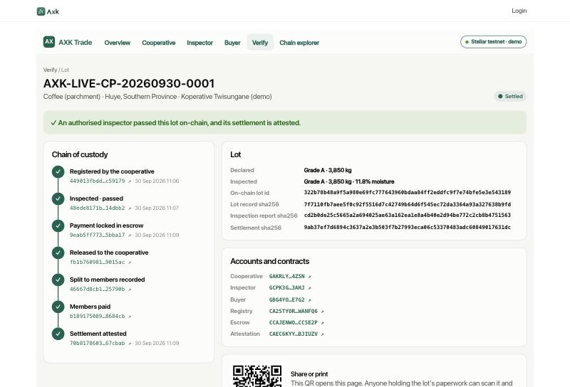

# AXK Network — Verification & Settlement Layer

**Capstone project · BSE Software Engineering (Low-Level / Blockchain track) · African Leadership University · 2026**
Oghenetejiri Jesse · Supervisor: Junior Turatsinze

Cross-border agricultural trade in East Africa fails at two points: a buyer cannot verify a lot's quality,
custody and container integrity across a corridor, and settlement is slow, costly and hard to trust. This project
puts both in one verified workflow on Stellar. A cooperative registers a lot; an independent inspector signs it
off on-chain; a buyer locks payment into smart-contract escrow; an authorised logistics carrier takes custody under
a tamper-evident container seal; the port/terminal verifies the anti-tamper seal against the manifest and clears
customs; and upon delivery confirmation, smart contracts release payment, execute member revenue splits, and anchor
an immutable cryptographic attestation that anyone can verify via QR code.

- **Repository:** https://github.com/tejirijesse/axk-network-capstone
- **Demo Walkthrough Video (1080p Narrated, 3m 6s):** [docs/demo/axk-capstone-demo.mp4](docs/demo/axk-capstone-demo.mp4)
- **Pilot scope:** Kigali cooperatives on the Rwanda–DRC and Rwanda–Uganda corridors

[](docs/demo/axk-capstone-demo.mp4)

> 📹 **Video Walkthrough:** A complete, 1080p studio-narrated walkthrough of the entire end-to-end custody and settlement pipeline is available at [`docs/demo/axk-capstone-demo.mp4`](docs/demo/axk-capstone-demo.mp4).
> 
> **Chapters:**
> 1. `00:00` — **Introduction & Architecture**: Corridor trade risks and 6-stage Soroban custody state machine
> 2. `00:23` — **Cooperative Registration**: 4,500 kg Rwandan coffee lot lot registration & SHA-256 digest commitment
> 3. `00:46` — **Independent Inspection**: Physical quality grading (11.8% moisture, Grade A1) & on-chain attestation
> 4. `01:05` — **Buyer Escrow Funding**: 18,000,000 RWF smart contract lock bound to registered cooperative payee
> 5. `01:21` — **Logistics Carrier Dispatch**: Carrier vehicle assignment, cryptographic waybill, and tamper-evident container seal
> 6. `01:40` — **Port / Terminal Clearance**: Inbound gate-in, anti-tamper seal verification against manifest, and customs entry anchor
> 7. `01:58` — **Delivery Settlement & Splitter**: Buyer delivery release and on-chain 40/40/20 member revenue payout
> 8. `02:20` — **Public Trace & Dynamic QR**: Zero-login corridor audit with dynamic SVG QR code and 4-hash verification
> 9. `02:44` — **Live Stellar Chain Explorer**: Real-time testnet event streaming, transaction hashes, and immutable proof

---

## How it works

One trade, top to bottom. In each step a participant acts (grey), the application layer signs/hashes the transaction
(purple), and Soroban contracts on Stellar testnet enforce the rules and custody timeline (green).



1. **Register.** The cooperative commits a SHA-256 digest of the lot record; only the digest goes on-chain.
2. **Inspect.** An authorised independent inspector signs one pass or reject with moisture & grade readings. Permanent & tamper-evident.
3. **Escrow.** The buyer funds escrow; locked funds are bound to the verified cooperative payee.
4. **Logistics.** The transport carrier takes physical custody, issues a cryptographic waybill, and applies a tamper-evident seal.
5. **Port / Terminal.** Port gate-in verifies the container seal against the waybill manifest and files the customs clearance receipt.
6. **Settle & Verify.** Delivery confirmation releases escrow, records the 40/40/20 cooperative member split, and anchors the final attestation. Anyone can inspect the complete timeline at `/trace` with zero login.

Full schematic, message sequence, state machines and data model: [docs/architecture.md](docs/architecture.md).

## What it does

| Role | Screen | What happens on-chain |
|---|---|---|
| Cooperative | `/trade/coop` | Registers agricultural lots: commits SHA-256 digest of lot record to **lot registry** bound to cooperative address |
| Inspector | `/trade/inspect` | Physical & lab grading queue: signs immutable pass/reject attestation with grade, moisture and sample notes |
| Logistics | `/trade/logistics` | Carrier custody & dispatch: vehicle plate, driver assignment, container seal issuance, cryptographic waybill digest anchor |
| Port / Terminal | `/trade/port` | Inbound gate-in & clearance: anti-tamper seal verification against manifest, customs entry reference, port receipt anchor |
| Buyer | `/trade/buy` | Escrow & settlement: funds smart-contract escrow, confirms delivery release, triggers **splitter** (40/40/20 member payout) and final **attestation** |
| Anyone | `/trace` | Public verification: look up by reference, hash or scan QR code; verifies all 4 cryptographic hashes with zero personal data |
| Anyone | `/chain` | Chain Explorer: live Stellar testnet money flow, custody milestones, in-browser cryptographic verifier, and 5-year history |

The five operational roles represent the practical core of AXK's physical and financial cross-border trade workflow.

## Screenshots

| | |
|---|---|
|  **Cooperative** — register a lot, follow it to payment |  **Inspector** — oldest-first queue, measured values, pass or reject with a reason (j/k/a/r keys) |
|  **Buyer** — inspected lots only, escrow, confirm delivery, download the verified record, share a link |  **Lot** — seven on-chain steps, records re-hashed in the browser and confirmed by the contracts |
|  **Public trace** — read-only verification with QR, no login |  **Chain explorer** — live Stellar testnet flow and verification events |

## Designs

- [System schematic, trade sequence, state machines and data model](docs/architecture.md)
- [Security: roles, 14 contract guarantees and the test that pins each, application controls, known limits](docs/security.md)
- [Contract reference and design rationale](contracts/README.md)
- [Testnet deployments and what was exercised on-chain](docs/deployments.md)

## Tech stack

| Layer | Technology |
|---|---|
| Smart contracts | Rust, Soroban (`soroban-sdk` 22), `wasm32v1-none` — lot registry, escrow, splitter, attestation |
| Chain | Stellar testnet; RWF test token (Stellar Asset Contract) as the local-currency stand-in |
| Signing | `stellar-cli` 28, custodial per-role testnet identities |
| Application | Frappe v15 + ERPNext v15, Python 3.11, MariaDB 10.11, Redis |
| Frontend | Frappe web pages, vanilla JavaScript, hand-built SVG charts (no chart library) |
| Chain reads | `stellar-sdk` (Python) against Soroban RPC |

## Repository layout

```
contracts/            Soroban workspace: lot_registry, escrow, splitter, attestation (65 tests)
frappe_app/axk_capstone/
  axk_capstone/chain.py        custodial signer: every contract call, argument lists, no shell
  axk_capstone/trade_api.py    role endpoints and the access guard
  axk_capstone/verify.py       public lookup, PII-free fields, QR
  axk_capstone/stellar_live.py Soroban RPC event reader for the explorer
  axk_capstone/www/            /trade/*, /trace/*, /chain pages
  axk_capstone/public/         axk.css, trade.js, chain.css, chain.js
axk_seed/             synthetic five-year dataset + importer (labelled synthetic everywhere)
scripts/demo.sh       deploys fresh contracts and runs one verified trade on testnet
scripts/run-frappe.sh starts the local Frappe stack
docs/                 architecture, security, deployments, screenshots
Makefile              one command per task (`make help`)
```

## Quickstart & Setup

You can run AXK Capstone in two ways:
1. **Instant Standalone Runner (Recommended for Evaluation):** Zero external dependencies required (no bench, MariaDB, or Redis). Starts in 2 seconds with pre-seeded testnet-verified lots.
2. **Full Frappe Stack:** Complete Frappe v15 / ERPNext integration.

---

### Option 1: Instant Standalone Runner (Zero Dependencies)

Runs the complete 5-role dashboard suite and public verification immediately using standard Python 3:

```bash
git clone https://github.com/tejirijesse/axk-capstone.git
cd axk-capstone
make run    # or: python3 scripts/server.py
```

Open `http://localhost:8000/trade` in your browser. All 5 operational dashboards and public verification are live:

| Dashboard / Surface | URL | Purpose |
|---|---|---|
| **Overview** | `http://localhost:8000/trade` | 5-role custody flow & active trades overview |
| **Cooperative** | `http://localhost:8000/trade/coop` | Lot registration, variety, harvest, origin |
| **Inspector** | `http://localhost:8000/trade/inspect` | Physical & lab inspection, moisture testing, pass/reject |
| **Logistics** | `http://localhost:8000/trade/logistics` | Carrier custody, vehicle plate, waybill, tamper-evident seal |
| **Port / Terminal** | `http://localhost:8000/trade/port` | Inbound gate-in, anti-tamper seal verification, customs clearance |
| **Buyer** | `http://localhost:8000/trade/buy` | Escrow funding, delivery release, 40/40/20 member split, attestation |
| **Public Verification** | `http://localhost:8000/trace` | Look up by lot ref, digest or scan QR code |
| **Chain Explorer** | `http://localhost:8000/chain` | Real-time Stellar testnet money flow and cryptographic verifier |

---

### Option 2: Full Frappe / Bench Stack

For full Frappe v15 development environments:

```bash
# 1. Start bench stack
make run-frappe    # starts Frappe at http://axk.localhost:8000

# 2. Or install app into an existing bench:
make install-app
make contracts-config
```

---

## Testing

Run the full dual test suite (Smart Contracts + End-to-End Integration & Failure Modes):

```bash
make test
```

- **Contract Tests (65 tests):** Soroban workspace unit tests covering 14 security guarantees across `axk_lot_registry`, `axk_escrow`, `axk_splitter`, and `axk_attestation`.
- **Integration Tests (7 tests):** Comprehensive python test suite (`scripts/test_trade.py`) exercising the full 6-stage lifecycle, failure modes (inspection rejection, container seal tampering, invalid state transitions, 404 handling), and cryptographic digest verification.

You can also run them independently:
```bash
make test-contracts    # Cargo test suite (65 tests)
make test-python       # Python integration & failure-mode suite (7 tests)
```

---

## Walkthrough

1. **Cooperative** (`/trade/coop`): Register a commodity lot (e.g., Beans, grade A, 8,000 kg). Canonical digest committed on-chain.
2. **Inspector** (`/trade/inspect`): Grade the lot, measure moisture, and sign an approval or rejection.
3. **Buyer** (`/trade/buy`): Deposit funds into smart-contract escrow. Funds are locked strictly for the registered cooperative.
4. **Logistics** (`/trade/logistics`): Dispatch carrier with driver, vehicle plate, and tamper-evident container seal.
5. **Port / Terminal** (`/trade/port`): Cargo arrives at port gate-in. Anti-tamper seal is verified against manifest and customs entry is anchored.
6. **Buyer & Public** (`/trade/buy` & `/trace`): Buyer confirms delivery release. Escrow pays out, revenue splitter executes 40/40/20 distribution to cooperative members, and the final attestation anchor is written on Stellar testnet. Anyone can scan the QR code to verify the entire cryptographic audit trail.
7. **Public trace** (`/trace`): Share link or scan QR code; instant cryptographic verification without login or personal data exposure.
8. **Chain explorer** (`/chain`): Live Stellar testnet money flow and ledger events; tamper with a synthetic event to see the cryptographic hash chain break.

## Test Matrix

| Suite | Count | Focus / Guarantees | Command |
|---|---|---|---|
| **Lot registry** | 18 | Write-once registration, authorized inspectors, admin controls | `cargo test -p axk-lot-registry` |
| **Escrow** | 27 | Inspection gating, buyer authorization, fixed payee, refund timeouts | `cargo test -p axk-escrow` |
| **Splitter** | 12 | Exact 40/40/20 division, rounding remainder protection, member payout | `cargo test -p axk-splitter` |
| **Attestation** | 8 | Immutable digests, ledger anchor, role-based attester gating | `cargo test -p axk-attestation` |
| **End-to-End Integration** | 7 | 6-stage lifecycle, seal tampering, invalid transitions, route rendering | `python3 scripts/test_trade.py` |
| **Stellar Testnet Demo** | 10 steps | Live on-chain deployment, Friendbot funding, live tx hashes | `make demo` |
| **Full Combined Suite** | **72 tests** | All contracts + integration & failure-mode test paths | `make test` |

The end-to-end runs and the exact contract error codes observed on-chain are recorded in
[docs/deployments.md](docs/deployments.md).

## Deployment plan

| Stage | Where | What changes |
|---|---|---|
| **1 · Local (now)** | Frappe bench on a laptop · Stellar testnet | Demo mode on loopback only; demo keys in the stellar-cli keystore; synthetic history for the explorer |
| **2 · Pilot (3 months, Kigali)** | One Ubuntu 22.04 VM (2 vCPU, 8 GB) via AXK's Ansible self-host playbook · HTTPS · Stellar testnet | Demo mode **off**; one Frappe user per participant with role permissions; per-role keys moved to a managed key store; nightly backups; an event indexer so history outlives the RPC's ~7-day window; ~30–50 traders and one cooperative |
| **3 · Production** | Managed VM per tenant · Stellar mainnet | External contract audit first; registry admin, verifier, coordinator and attester held by four separately custodied keys; RWF test token replaced by a regulated stablecoin; cash-out to mobile money through a SEP-24 anchor; monitoring and alerting on failed transactions |

**Deploying a release**

```bash
# contracts (per network)
make build
stellar contract deploy --wasm contracts/target/wasm32v1-none/release/axk_lot_registry.wasm \
  --source <admin> --network <net> -- --admin <admin-address>
stellar contract deploy --wasm contracts/target/wasm32v1-none/release/axk_escrow.wasm \
  --source <verifier> --network <net> -- --verifier <verifier-address> --registry <registry-id>
# … splitter (--coordinator) and attestation (--attester) the same way, then add_inspector for each inspector

# application
bench get-app <axk-capstone repository>        # or pull the new tag
bench --site <site> install-app axk_capstone     # first time; `bench --site <site> migrate` after
bench build --app axk_capstone
bench --site <site> set-config --parse axk_stellar '{"network":"<net>","registry":"…","escrow":"…","splitter":"…","attestation":"…","token":"…"}'
bench --site <site> set-config axk_demo_mode 0
bench restart
```

Contracts are immutable once deployed; a new version means new contract IDs and a config change, and trades
already open on the old escrow finish there. Roll back the application with `git checkout <previous-tag>`
followed by `bench --site <site> migrate && bench build`.

## Data honesty

The five-year history on `/chain` (646 lots, 5,258 verification events, 549 orders, 176 escrows) is
**synthetic seed data** generated to populate the demo. Every row is tagged `axk_synthetic_seed = 1` and every
screen that shows it says so. It is not pilot evidence and no finding in the capstone report is drawn from it.
Everything under `/trade` and `/trace`, and the live sections of `/chain`, are real Stellar testnet transactions.

## Provenance

The escrow, splitter and attestation contracts originate in AXK Network, the author's venture
(`AXKNETWORK/axk-stellar`, MIT). In this capstone the escrow was rebuilt around the new lot registry
(inspection gate, payee from the registry, one live escrow per lot). The lot registry, the Frappe app, the
demo script and the explorer were written for this capstone.

## License

MIT — see [LICENSE](LICENSE).
